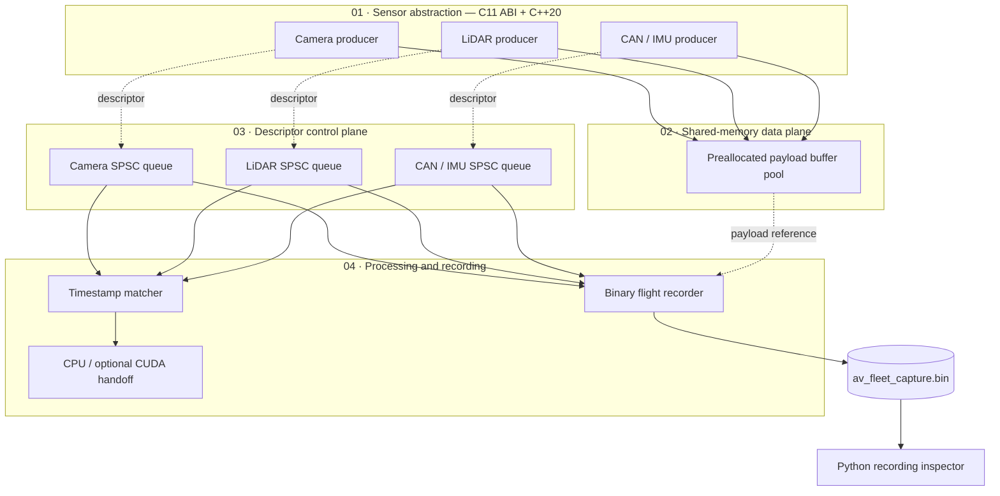

<div align="center">

# 🚗 AV Zero-Copy Sensor Middleware

### A modern C++20 / C11 sensor-ingestion and telemetry middleware prototype

**Shared-memory transport · Lock-free SPSC queues · Timestamp alignment · Binary recording · Optional CUDA integration**

<br/>


</div>

---

## ✨ Project at a glance

AV Zero-Copy Sensor Middleware is a systems-programming prototype that explores a modular data path for autonomous-vehicle sensor workloads. It combines a C-compatible sensor interface with modern C++ components for shared-memory buffer management, SPSC queues, timestamp matching, CPU/GPU memory handoff, and binary telemetry recording.

<table>
<tr>
<td width="50%" valign="top">

### ⚡ Data-path engineering
- Shared-memory payload pool
- Atomic buffer reference counting
- Cache-aligned SPSC queues
- Pre-touched memory pages

</td>
<td width="50%" valign="top">

### 🧭 Platform integration
- C11 driver-facing ABI
- Timestamp-based sensor matching
- Optional CUDA mapped host memory
- CPU-only fallback path

</td>
</tr>
<tr>
<td width="50%" valign="top">

### 🧪 Verification
- CTest unit-test target
- CRC32 recording validation
- Python log inspection
- Debug sanitizer build option

</td>
<td width="50%" valign="top">

### 📦 Runtime
- Staged service initialization
- Reverse-order shutdown
- Binary flight-recorder output
- Configurable sample duration

</td>
</tr>
</table>

> [!NOTE]
> **Project scope:** This is a software prototype and benchmark harness. The sample sensor streams and measurements are generated by the application; they are not evidence of operation with physical vehicle sensors, an NVIDIA DRIVE platform, production DMA, or automotive safety certification.

## 🧱 Technology stack

| Layer | Technology |
|---|---|
| Application | C++20 |
| Driver-facing interface | C11 ABI |
| Concurrency | C++ atomics, SPSC ring buffers |
| Memory / IPC | POSIX shared memory, `mmap`, `mlock` fallback |
| GPU integration | Optional CUDA mapped host allocation |
| Build system | CMake, shell build runner |
| Testing | CTest |
| Telemetry inspection | Python 3 |

## 🗺️ System architecture



The payload pool and descriptor queues are separate: queues carry metadata and buffer references while payload bytes remain in the shared pool. This diagram represents the intended software data flow; real hardware capture and DMA require platform-specific driver integration.

## 🔍 Core modules

<details open>
<summary><strong>01 · C11 sensor ABI</strong> — <code>include/abi/sensor_c_abi.h</code></summary>

Defines a C-facing sensor descriptor interface so C and C++ components can exchange a plain-data representation. Cache-aligned descriptors are used to reduce the likelihood of unrelated queue metadata sharing a cache line.

</details>

<details>
<summary><strong>02 · Shared-memory buffer pool</strong> — <code>include/core/shm_pool.hpp</code></summary>

Maps a preallocated region and touches its pages during initialization to reduce first-touch page faults during normal processing. It checks available `/dev/shm` capacity and can fall back to an anonymous shared mapping when POSIX shared-memory allocation is unavailable.

Buffer ownership lifecycle:

1. Producer acquires a free slot.
2. Consumers retain a reference when sharing a payload.
3. Each consumer releases its reference after processing.
4. The slot becomes reusable when its reference count reaches zero.

Validate process-sharing guarantees for atomics and mappings on the intended target platform.

</details>

<details>
<summary><strong>03 · Lock-free SPSC ring buffers</strong> — <code>include/core/lockfree_ring.hpp</code></summary>

Uses separate cache-aligned producer and consumer indices with acquire/release ordering to publish descriptors between one producer and one consumer. This implementation is SPSC; it is not an MPMC queue.

</details>

<details>
<summary><strong>04 · Timestamp alignment</strong> — <code>include/core/time_sync.hpp</code></summary>

Maintains bounded history windows and matches auxiliary sensor timestamps against an arriving camera timestamp. The supplied default configuration emits a bundle when the maximum timestamp difference is within 25 ms.

This is timestamp matching, not a complete IEEE 1588 PTP clock-synchronization implementation. Accurate PTP operation requires synchronized hardware clocks and platform integration.

</details>

<details>
<summary><strong>05 · CPU / GPU memory handoff</strong> — <code>include/core/gpu_handoff.hpp</code></summary>

When CUDA is available and enabled, the CUDA path can allocate mapped host memory and obtain a device-visible pointer. On a CPU-only build, the fallback uses aligned host memory and attempts to lock it with `mlock`.

The fallback models the host-memory allocation/pinning aspect. It is **not** a GPU DMA transfer and does not establish zero-copy CPU-to-GPU operation. Validate CUDA behavior on supported NVIDIA hardware and drivers.

</details>

<details>
<summary><strong>06 · Binary recorder and CRC32</strong> — <code>include/core/serializer.hpp</code>, <code>tools/inspect_recording.py</code></summary>

Writes a packed 44-byte header followed by payload bytes. CRC32 is used to detect accidental corruption in the recording workflow.

| Offset | Size | Field | Description |
|---:|---:|---|---|
| `0x00` | 4 B | `magic` | `0x41564452` (`AVDR`) |
| `0x04` | 2 B | `version` | Protocol version |
| `0x06` | 2 B | `sensor_type` | Sensor type enum |
| `0x08` | 4 B | `sensor_id` | Sensor instance identifier |
| `0x0C` | 8 B | `sequence_id` | Per-sensor sequence counter |
| `0x14` | 8 B | `hw_timestamp_ns` | Hardware capture timestamp |
| `0x1C` | 8 B | `ingest_timestamp_ns` | Middleware arrival timestamp |
| `0x24` | 4 B | `payload_length` | Payload size in bytes |
| `0x28` | 4 B | `payload_crc32` | CRC32 of payload |

The documented format is little-endian. Cross-architecture interchange should explicitly encode/decode endianness rather than relying on native struct layout.

</details>

<details>
<summary><strong>07 · Service lifecycle</strong> — <code>include/runtime/service_manager.hpp</code></summary>

Initializes services in dependency stages and shuts them down in reverse order. The supplied design brings up memory resources before consumers and sensor producers, then tears producers down before consumers and memory resources.

</details>

## 📊 Sample benchmark snapshot

The following values are transcribed from the supplied sample run:

```bash
./build.sh --cuda --duration=2
```

The run was performed on a CPU-only Linux environment where CMake did not find the CUDA toolkit. The GPU handoff therefore used the POSIX `mlock` fallback. These are application-reported sample measurements, not portable performance guarantees.

### Build and test environment

| Item | Sample result |
|---|---|
| Build configuration | Release |
| Compiler | GNU 13.3.0 |
| CUDA option | Requested |
| CUDA toolkit | Not found |
| Handoff backend | CPU-side `mlock` fallback |
| CTest | 1/1 test passed |
| Runtime duration | 2 seconds |

### Startup measurements

| Service | Reported initialization |
|---|---:|
| Shared-memory pool | 0.36 µs |
| GPU handoff initialization | 0.09 µs |
| Fusion and recorder | 74.24 µs |
| Camera producer | 61.90 µs |
| LiDAR producer | 42.57 µs |
| CAN / IMU producer | 40.59 µs |
| **Full stack** | **0.378 ms** |

### Ingest telemetry

| Stream | Packets | Data volume | Avg. ingest latency | Max. ingest latency |
|---|---:|---:|---:|---:|
| CAN / IMU | 401 | 0.11 MB | 0.34 µs | 0.83 µs |
| LiDAR | 41 | 10.25 MB | 8.06 µs | 8.84 µs |
| Camera | 62 | 31.00 MB | 16.00 µs | 20.67 µs |
| **Total** | **504** | **41.37 MB** | — | — |

**Additional sample observations:** 41 timestamp-matched bundles, zero reported dropped packets, zero reported CRC errors, 2307.91 µs average end-to-end latency, and 12302.37 µs maximum end-to-end latency.

## 🖥️ Sample execution output

```text
Mode: Release | CUDA: ON | Duration: 2s

CMake Warning:
AV_ENABLE_CUDA=ON requested, but CUDAToolkit was not found.
Falling back to POSIX mlock DMA simulation.

[Build] C and C++ targets compiled successfully.
[Test] CorePipelineTests: Passed
[Test] 100% tests passed, 0 tests failed.

[BOOT-UX] Full AV Platform Operational in 0.378 ms
[RUNTIME] Streaming, timestamp-aligning and recording for 2 seconds...
[SHUTDOWN] Services stopped in reverse dependency order.

=============== AV PLATFORM TELEMETRY SUMMARY ===============
POSIX SHM Segment       : /av_drive_sensor_pool (256 MB)
GPU Handoff Backend     : Page-Locked mlock fallback
Camera Frames Pub/Drop  : 62 / 0
LIDAR Packets Pub/Drop  : 41 / 0
CAN/IMU Msgs Pub/Drop   : 401 / 0
PTP Synced GPU Bundles  : 41 (Avg Skew: 9.07 ms)
Total Frames Processed  : 504
CRC32 Integrity Errors  : 0
Avg End-to-End Latency  : 2307.91 us
Max End-to-End Latency  : 12302.37 us
Fleet Log Written       : av_fleet_capture.bin (41.37 MB)

[SUCCESS] Build, CTest, and fleet log verification complete.
```

## 📁 Repository structure

```text
AV-ZeroCopy-Sensor-Middleware/
├── .github/
│   └── workflows/
│       └── ci.yml
├── CMakeLists.txt
├── build.sh
├── include/
│   ├── abi/
│   │   └── sensor_c_abi.h
│   ├── core/
│   │   ├── gpu_handoff.hpp
│   │   ├── lockfree_ring.hpp
│   │   ├── serializer.hpp
│   │   ├── shm_pool.hpp
│   │   └── time_sync.hpp
│   ├── runtime/
│   │   └── service_manager.hpp
│   └── sal/
│       └── sensors.hpp
├── src/
│   └── main.cpp
├── tests/
│   └── test_suite.cpp
└── tools/
    └── inspect_recording.py
```

## 🚀 Quick start

### Prerequisites

- Linux
- CMake
- GCC or Clang with C++20 and C11 support
- POSIX threads and shared-memory APIs
- Python 3 for recording inspection
- CUDA Toolkit and supported NVIDIA driver/GPU only for CUDA-path testing

### Build and run

```bash
# Default build and sample run
./build.sh

# Run a 2-second sample
./build.sh --duration=2

# Request CUDA; use fallback if unavailable
./build.sh --cuda --duration=2

# Explicitly disable CUDA
./build.sh --no-cuda

# Debug build with sanitizers
./build.sh --debug --duration=2
```

### Manual CMake workflow

```bash
cmake -S . -B build \
  -DCMAKE_BUILD_TYPE=Release \
  -DAV_ENABLE_CUDA=ON

cmake --build build --parallel
ctest --test-dir build --output-on-failure

./build/av_middleware_node 5
python3 tools/inspect_recording.py av_fleet_capture.bin
```

## 🛡️ Engineering notes

| Topic | Design consideration |
|---|---|
| Backpressure | Non-blocking queue operations and explicit drop counters can avoid indefinite producer waits. Define the correct drop policy per sensor and safety requirement. |
| Queue topology | The supplied ring buffer is SPSC. Use one queue per producer/consumer pair or implement and validate another topology. |
| Shared-memory correctness | Validate ownership transitions, process-shared atomic behavior, memory ordering, crash recovery, and cleanup on target platforms. |
| Real-time behavior | Pre-touching pages can reduce first-touch faults, but does not provide hard real-time guarantees by itself. |
| CUDA behavior | A CPU fallback build does not validate CUDA execution, device pointer mapping, DMA performance, or GPU compatibility. |
| PTP behavior | Timestamp matching does not synchronize clocks. Validate clock synchronization and timestamp provenance separately. |
| Automotive deployment | No ISO 26262 compliance, production vehicle qualification, or safety certification is claimed. |

## 🔭 Future validation & production readiness

The following are **planned validation activities**, not claims that every item has already been completed:

- [ ] Build and run on the intended Linux distribution and compiler.
- [ ] Run tests under AddressSanitizer and UndefinedBehaviorSanitizer.
- [ ] Stress buffer acquisition, reference counting, and queue wraparound.
- [ ] Test shutdown while buffers are outstanding.
- [ ] Verify shared-memory behavior across intended process boundaries.
- [ ] Test CUDA allocation and device-pointer access on supported NVIDIA hardware.
- [ ] Verify hardware timestamp sources and PTP clock synchronization.
- [ ] Measure latency distributions, including percentiles, on target hardware.
- [ ] Confirm resource limits, memory-lock permissions, and cleanup behavior.

## 📄 License

Add the repository's actual license here before publishing. No license is inferred by this README.

---

<div align="center">

**Built to explore low-level systems engineering for sensor-rich platforms.**

<sub>C++20 · C11 · Linux · Shared Memory · Concurrency · Telemetry</sub>

</div>
